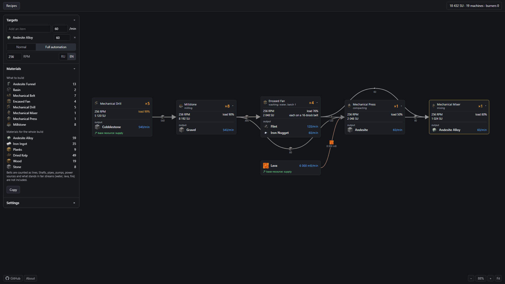

# CreateCalculated

CreateCalculated is a production calculator for Create mod and Create addons, written in Rust with a web UI.



**Open the calculator: [createcalculated.vercel.app](https://createcalculated.vercel.app)**

## Addons

The calculator works with Create 6.0.10 on Minecraft 1.21.1. Add an addon by its [Modrinth](https://modrinth.com/mods) name, then restart the server:

```sh
createcalc-recipes --mod createaddition
createcalc-icons --mod createaddition
```

Addon recipes of the types Create already has are planned like any other. Recipe types an addon brings itself are skipped and listed when the recipes are built, because the calculator does not know those machines yet. An item made only on such a machine shows a warning and counts as a raw material.

| Addon | Status |
|---|---|
| [Create Crafts & Additions](https://modrinth.com/mod/createaddition) 1.6.0 | Partly: 46 recipes work. Rolling, charging and liquid burning are skipped, so copper wire and other rolled items count as raw materials |
| Other addons | Not tested, the same rules apply |

## Run a release

Download the archive from [Releases](https://github.com/MekoNix/CreateCalculated/releases).

```sh
tar xzf createcalc-0.1.0-linux-x86_64.tar.gz
cd createcalc-0.1.0
./createcalc-server
```

It asks once before downloading the game files, about 60 MB, builds recipes and item pictures on your computer and opens on http://127.0.0.1:3000/.

To keep it running on a server, install it as a service on port 3000:

```sh
sudo ./install.sh
```

Options: `--prefix DIR`, default `/opt/createcalc`, `--address 127.0.0.1:3000` and `--no-service`. The server has no login, so keep it behind a firewall or a reverse proxy if it should not be public.

## Build from source

You need [Rust](https://rustup.rs), a C compiler and `make`.

```sh
git clone https://github.com/MekoNix/CreateCalculated.git
cd CreateCalculated
make run
```

## Languages

The page is available in English and Russian.

Want it in your language? [Open an issue with the `Translate` label](https://github.com/MekoNix/CreateCalculated/issues/new?template=translation.md) and fill in [the table with all the text on the site](translations.csv).

## Licenses

**CreateCalculated:** no license has been chosen yet.

Game files are not part of this repository or its releases, apart from the item pictures in the screenshot above. The programs download them on your computer, read them as archives and build everything locally. This project is not affiliated with Mojang or the Create team.

- [Create](https://modrinth.com/mod/create): code under the MIT license, assets All Rights Reserved, see [its license](https://github.com/Creators-of-Create/Create/blob/mc1.21.1-6.0.10/LICENSE.md).
- [Minecraft](https://www.minecraft.net/): by Mojang, under the [Minecraft EULA](https://www.minecraft.net/en-us/eula).
- [NeoForge](https://neoforged.net/): [LGPL 2.1](https://github.com/neoforged/NeoForge/blob/1.21.1/LICENSE.txt). We use NeoForge tags to build solutions.

Addons, used only when you ask for them:

- [Create Crafts & Additions](https://github.com/mrh0/createaddition): MIT license.
